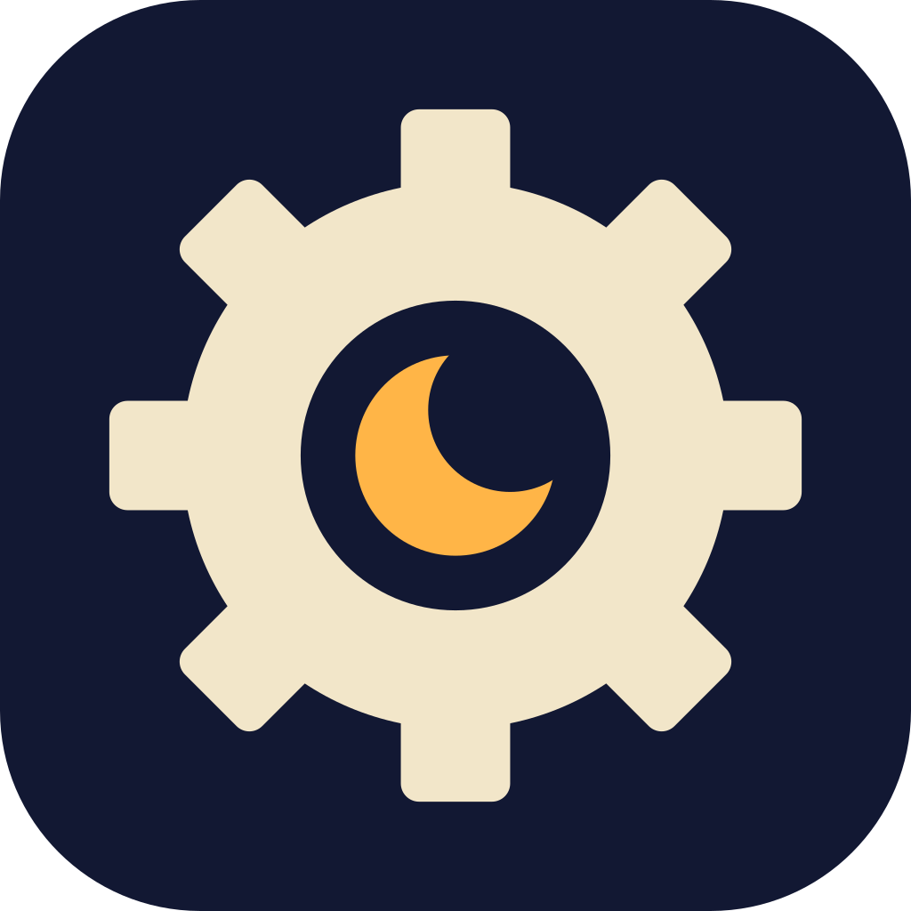
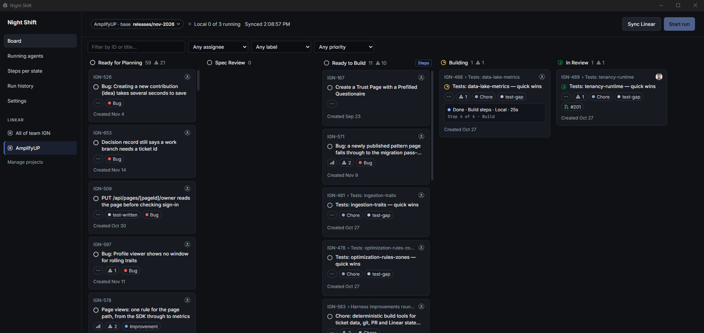

# Night-Shift
Project Night Shift a tool to help me run/manage my Agentic Software Factory.

Electron app that shows the Linear board and the agent runs side by side, and runs scripted steps (worktree, `npm ci`, Linear moves) before handing off to Claude Code.



## Run it

Needs Node 22 or later (tested on Node 24 with Electron 45) and Git. Electron downloads its binary the first time it runs.

```
npm install
npm run dev
```

## Install on another computer

1. Install [Node 22+](https://nodejs.org) and Git, then clone this repo.
2. Build the installer and run it:

   ```
   npm install
   npm run dist
   ```

   This makes `dist\Night Shift Setup <version>.exe`. It's a one-click install for your user only (no admin needed) and adds Start menu and desktop shortcuts. It isn't code-signed yet, so SmartScreen asks first: choose **More info › Run anyway**. To run it without installing, use `npm run dist:dir` and open `dist\win-unpacked\Night Shift.exe`, or skip packaging and use `npm run dev`. Installed copies update themselves. Releases are published with `npm run release` (see [docs/releasing.md](docs/releasing.md)).
3. On the first computer, **Settings › Export settings** saves `night-shift-settings.yml`. Copy it over and use **Settings › Import settings…**. It shows what's in the file (Linear, Repository, Worktrees, Runs, Projects, Automations); untick anything you don't want, then **Import selected**. Automations arrive switched off, so two machines don't run the same agents; turn on the ones this machine should run. If the repo path doesn't exist on the new machine, the local one is kept and you're told.
4. Paste your Linear API key in Settings. It's never in the exported file; each machine stores its own, encrypted for that Windows user.

The installed app and `npm run dev` share the same settings and run history.

## Base branch

The base branch changes every release. Click the **project · base &lt;branch&gt;** chip at the top of the board to pick another branch from the repo (**Fetch** pulls new ones from origin). It saves straight away.

Then open **Settings** and fill in:

- **Linear API key**: Linear › Settings › Security & access › Personal API keys. Stored encrypted with the OS keychain.
- **Linear team key**: e.g. `IGN`
- **Repo path**: the checkout agents work in, e.g. `C:\Development\auto-personalization-poc`
- **Base branch**: where new worktrees start, e.g. `releases/nov-2026`
- **New worktrees**: either Night Shift creates them at a path you choose (`$REPO/.claude/worktrees/$ID` by default; `$REPO`, `$ID`, `$TICKET`, `$BRANCH` are filled in), or the agent decides and Night Shift creates none. A state can override this with a `worktree:` block in `steps.yml`.

Settings live outside this repo, in `%APPDATA%\night-shift\settings.json` (Windows), next to run history in `runs\`. They survive rebuilds, `npm install` and fresh clones. The Linear API key is stored encrypted with Windows DPAPI, so the file can't be copied to another machine or user.

## Projects and filters

A **project** is a named slice of the team's tickets, linked to one or more Linear projects (Settings › Projects). Projects are listed under **Linear** in the left nav; picking one limits the board, and automatic runs, to tickets in its Linear projects. **All of team** shows everything. The choice is remembered.

The filter bar above the board narrows what's shown by ID or title, assignee, label and priority. Filters only change the view; they reset when you switch project.

## Automations

The **Automations** page schedules agent runs. Each automation picks tickets from a project and one or more Linear states, and runs the action set up for each state (states without an action can't be picked). Two kinds:

- **Watch for tickets**: checks on every Linear sync and picks tickets up as they arrive, at any time or within set days and hours. Per ticket: once each time it arrives in the state, or any number of times with a cooldown. A limit on how many of its runs go at once keeps it from queuing a whole column.
- **On a schedule**: fires every N minutes within set days and hours, starting up to N tickets each time (highest priority first). It can stop after a set number of runs and switch itself off. With **Only run when the state has tickets**, an empty state doesn't use up a run; it checks again in a minute.

New automations start switched off. **Run now** checks straight away, ignoring the schedule and hours. All runs share the max-local-runs limit in Settings, and Run history shows which automation started each run.

## Actions

An **action** is a named list of steps (scripts, Claude Code, Linear moves). It is available on tickets in any of its Linear states and shows in their card's **Actions ▾** menu under its **button label** (e.g. Review and Review fix on In Review). A state can have several actions; two actions on the same state need different labels. Automations on a state with several actions pick which one to run. Create, duplicate and edit actions on the **Actions** page; saving writes `.nightshift/steps.yml` in the repo agents work in (not this repo), so changes go through PRs. Without that file the built-in defaults are used. Older files with one block per state still load and are converted on the next save. Actions only say what runs; runs start from a card's Actions menu or from an automation. See `.nightshift/steps.example.yml` for every option.

Each action can also say what happens **if a run fails**: label the ticket in Linear (default "Agent failed"), comment with the failed step and the end of the log, and send it back to a state such as Ready to Build so an automation there runs it again. After a set number of failures in a row it stays put, and a successful run removes the label.

Each run:

1. Creates the worktree at the configured path on the ticket's Linear branch name (skipped when the agent decides)
2. Runs every later step inside that worktree, so Claude Code starts there and hooks see the right branch
3. Streams output to the run panel and saves the full log under the app's data folder

## How it gets Linear updates

Polling only (default every 60s, only the states shown on the board). No webhooks, no hosting.

## Not built yet

- Cloud runners (Claude Code cloud sessions, Managed Agents)
- Interactive terminals (runs are headless for now)
- Run windows and per-state run limits
